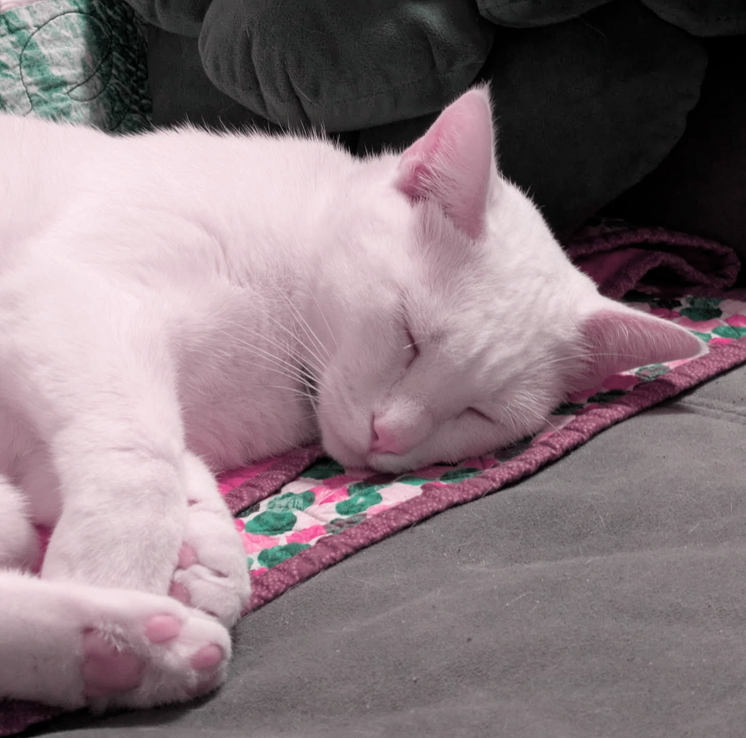

Hellooooooooo!

It's pumpkin season again! I have put a hat on my head a couple times this week. I'm looking for a new scarf too... The cold is coming, and I'm tapping my foot to the falling leaves.
## Reading

[The Last Samurai](https://www.theparisreview.org/blog/2016/06/10/the-trouble-of-rational-thought/) by Hellen Dewitt. A 500+ pager foisted on me by R. (I am thinking of you in the mango lolipop I just unwrapped.) How can one be so humbled by an eight-year-old boy? Holding his mother's hand in one, gripping Homer's *Oddyssey* in two. Do you sometimes have dreams of seven-hour concertos? Tears falling onto the wings of winter geese? *The Last Samurai* is born in the rift between continents and the silence between words.

It was very good, and you should read it!
## Eating

Life happens, but I am still a chef!!! I have been making homemade pizza, bread, alfredos and curries... I'm really into making seitan (also foisted on me by R), a delicacy made new to me by my (relatively recent) vegetarianism.

It's strange to think about. Because I live with two vegetarians, I don't *feel* like a vegetarian. I rarely eat out as it is, so meat just isn't a factor in my life 95% of the time. Plus, I've had such a wonderful time learning how to become a master chef, and cooking with R is the highlight of my week. Trying something new is always fun, and it always turns out delicious.

Here are some of my favorite meals I have recently:
- **Yummy pasta alfredo**: literally so easy. Buy a thing of mushrooms, sautee them with garlic until tender. Toss in cream, parmesan, and a teeny bit of tomato paste until a good sauce. Then add cooked pasta, and top it off with crumbled Ritz crackers. If you want more protein in it, sauté-ing cubed tofu with the mushrooms always turns out good.[^1]
- **Easy ramen with a cooked egg**: I love this meal because it is so easy in an instapot. Just throw in the ramen with all of your sauces (soy sauce, hoison sauce, teryaki, veggie broth), fry up an egg on the side, and you're done. #YUM.
- **T's insane banana bread**: not taking credit for this but the banana bread my roommate has been making has been MMM so yummy.
## Listening

K got me into Taylor Swift! I have devoured the albums over the past two months. It's kind of a big deal to me. Too many favorites to list! In the past, when trying to get into her I listened to *Evermore*, but what did it for me this time around was *Red (Taylor's Version)*. It's such a good album!
## Peeping

R and I have decided to become Alfred Hitcock completionists, and we've been having a wild ride so far. We've focused on the ones neither of us have seen before, which has been *Rope*, *Dial M For Murder* (I'd seen this one before but a long time ago), and *Vertigo*. It has been so much fun!

Recently I've watched:
- The Backrooms: SCARY... but good
- The Wind Rises: lovely
- The Boy and the Heron: rewatch, but man this movie might be everything
- Nope: so good. haunts me kinda.
- Steven Universe: on the couch eating dinner
- [Kathleen Illustrated](https://youtube.com/@kathleenillustrated): inspring me to be less of a perfectionist. (Thank you T.)

~

I feel a particular gratitude this season for the wonderful people in my life. If you have helped me at any time, I am so grateful that our paths crossed. We're all doing the best we can do.

May your pumpkins be plenty,

Willa

[^1]: I kinda want to get a blender because I keep seeing blended tofu recipes and they look so good...
